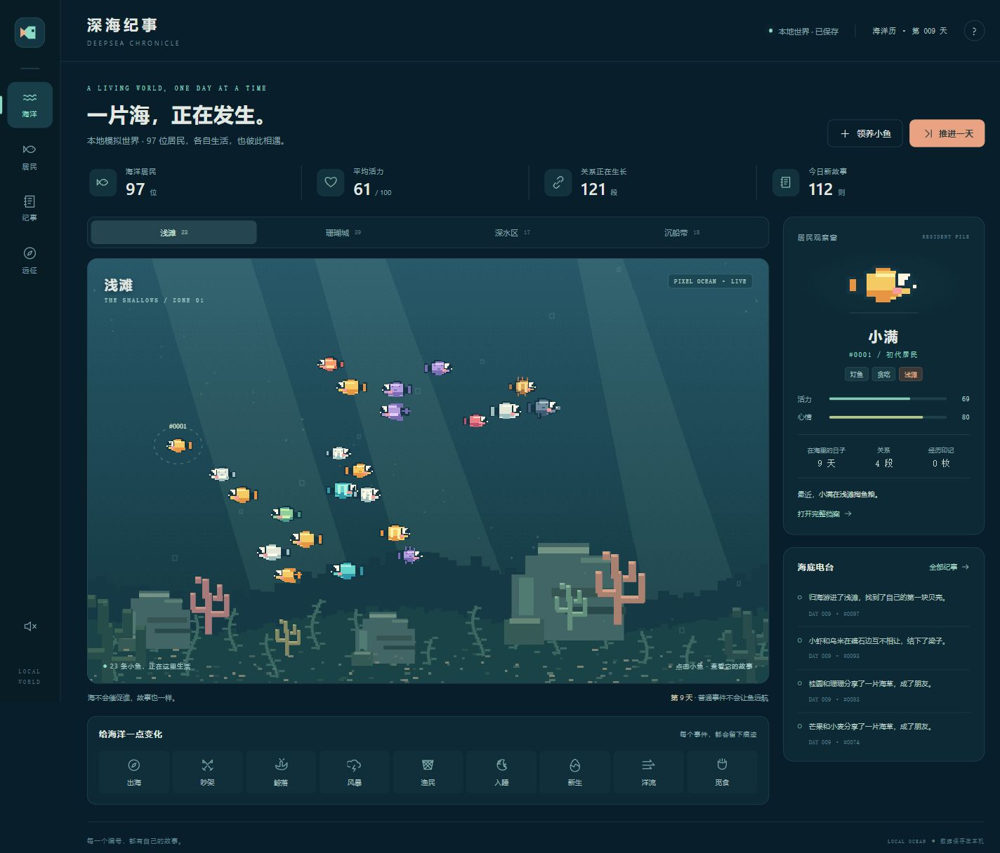

# 深海纪事

一片会积累经历的像素海洋。每个居民拥有永久编号，鱼的性格影响行为，关系随时间变化，纪事从世界记录中选出来。

这是可直接在本机运行的 v1：像素海洋、居民档案、每日演化、远征与世代、三池选材、投票导入、审核、竖屏视频导出均使用同一份世界数据。



## 打开成品

双击 **启动深海纪事.cmd**，然后在浏览器打开：

**http://127.0.0.1:3080/ocean/**

也可以在项目终端运行：

```powershell
npm.cmd start
```

停止时在运行终端按 Ctrl+C，或双击“停止深海纪事.cmd”。安装依赖后，运行、模拟和视频生成均不需要外部 AI 服务。

如果换电脑，需要 Node.js 22 或更新版本，首次先运行 `npm.cmd install`。视频编码器由项目依赖提供，无需单独安装 FFmpeg。

## 第一次体验

1. **进入海洋**：切换四个海区，点击一条游动的鱼，查看它的编号、性格、活力和心情。
2. **触发事件**：点底部“觅食”“鲸落”或“吵架”，观察画面和状态变化。所有事件都会保存。
3. **推进一天**：让所有在世居民演化一天，之后查看居民档案里的行为依据和关系。
4. **生成纪事**：进入每日纪事，查看三个主角、30 条群像和 100 秒分镜；故事附有日志来源。
5. **完成审核**：逐项检查五个条目，勾选后导出 15 秒样片或 100 秒正片。生成后可下载 MP4、JSON 和 Markdown 清单。
6. **体验远征**：选择路线和至少 50 条模拟鱼，公示名单，推进 1 个模拟日，再手动出发。也可以取消集结。出发后部分居民带伤归来，部分进入 D+3／D+5／D+7 孵化，历代档案保留。

## 演示数据与真实接入

首次启动内置 96 位模拟居民和 8 天演化记录，便于直接体验。从最初的 30 条模拟鱼世界升级时，会先备份到 `data/backups/world-step1.json`，再保留编号与名字进行扩充。

界面与视频会明确标识模拟世界。领养操作创建本地居民，不会绑定抖音账号。远征的 1 天反悔窗口使用模拟时间，适用于本地体验；面向真人运营时，应改为真实时间并接入真实报名和授权。

投票默认使用明确标注的模拟数据。纪事页导入入口接受 JSON；示例文件为 `inbox/votes.example.json`：

```json
{
  "votes": [
    { "nickname": "示例居民", "side": "A", "likes": 24 },
    { "nickname": "另一位居民", "side": "B", "likes": 18 }
  ]
}
```

按点赞数计票；同昵称同阵营重复数据取最高点赞，重复导入不会叠加。导入数据仅用于当天，下一天重新使用模拟票，除非另行导入。

本版未接入真实平台账号、评论接口或自动发布，也未向外网部署。平台接口资格和发布要求以正式接入时的平台规则为准。

## 世界规则

- 永久编号如 `#0001` 不变；某一世编号如 `#0001:g2` 单独保存。
- 普通事件只改变状态，不会使鱼远航；“新生”添加新居民，不会给原居民增加世代。
- 每条鱼最多 8 条关系。关系按永久编号连接，下一世继承关系与亲密度。
- 活力使用均值回归，有朋友、对头、海区风险和性格影响。
- 远征须满 50 位、经过 1 个模拟日反悔窗口并手动出发。
- 约 65% 远征参与者进入下一世孵化，其他参与者带着伤痕和故事归来。
- 行为日志保留最近 14 天；事件、居民和历代鱼档案保留。
- 每期从人气、故事、随机三池各选 10 条，去重共 30 条，三池各出一位主角。人数不足时按实际人数选材。
- 100 秒正片成功生成后，当天上镜次数只记录一次。15 秒预览不增加正式上镜次数；随机池提高未上镜居民权重。
- 世界变化后纪事重新生成并撤回旧审核，避免沿用失效的勾选。

## 文件位置

```text
深海纪事/
  启动深海纪事.cmd   双击启动
  server.mjs          本地 HTTP 服务
  web/                网页、像素精灵和实时海洋
  lib/                世界引擎、存储、选材、视频合成
  scripts/            命令行入口
  test/               自动化测试
  data/
    world.json        当前完整世界
    world.json.backup 最近一次成功修改前的世界
    backups/          第一版原始数据备份
    inbox/votes.json  当天导入的投票
    out/              审核清单、JSON、MP4
  docs/               原始蓝皮书、技术说明和验收记录
```

修改串行保存，使用临时文件和原子重命名；失败操作不覆盖世界。文件损坏时会报错并保留原文件，不会自动清空重建。

备份时停止服务，然后复制整个 `data` 文件夹。恢复时先保留当前文件副本，再用备份替换 `data/world.json` 并重新启动。

## 常用命令

```powershell
npm.cmd start                    # 启动成品
npm.cmd stop                     # 停止本项目服务，数据保留
npm.cmd run daemon               # 日更模式：运行期间每天上海时间09:00后生成待审清单
npm.cmd test                     # 自动测试
npm.cmd run world:create         # 创建最初的30条鱼；已有文件不会覆盖
npm.cmd run world:tick -- 1       # 离线推进一天；先停止网页服务
npm.cmd run render -- --preview  # 导出已审核的15秒样片
npm.cmd run render               # 导出已审核的100秒正片
```

网页服务与离线修改脚本不要同时运行，以免两个进程分别保存各自的内存快照。日常操作优先在网页完成。

日更模式需要持续运行；当天09:00后才启动时会补推进当天一次，不会一次补跑离线期间的所有天。它只生成待审清单，不会自动审核或对外发布。默认启动是手动推进的体验模式。

3080 端口被占用时，先检查成品是否已运行；也可在 PowerShell 设置 `$env:PORT=3081` 后运行 `npm.cmd start`。

## 视频规格

1080×1920、24fps、H.264＋AAC、最近邻放大的像素风。JS 绘制逻辑帧，与网页共用鱼精灵；FFmpeg 合成中文字幕、海洋氛围音和音效。

100 秒正片覆盖钩子、点赞计票、揭晓、三条主角、群像、结尾。15 秒样片压缩展示同一套分镜。视频明确标注 AI 生成与模拟数据。

## 验证

测试使用临时世界，不修改演示世界。涵盖 180 天模拟、关系上限、世代继承、并发读取与写入、失败回滚、HTTP 流程、选材去重、投票校验和审核门。

详细实测见 `docs/验收报告.md`。蓝皮书中的行业数字与旧性能数字不作为本版已经验证的结果。
